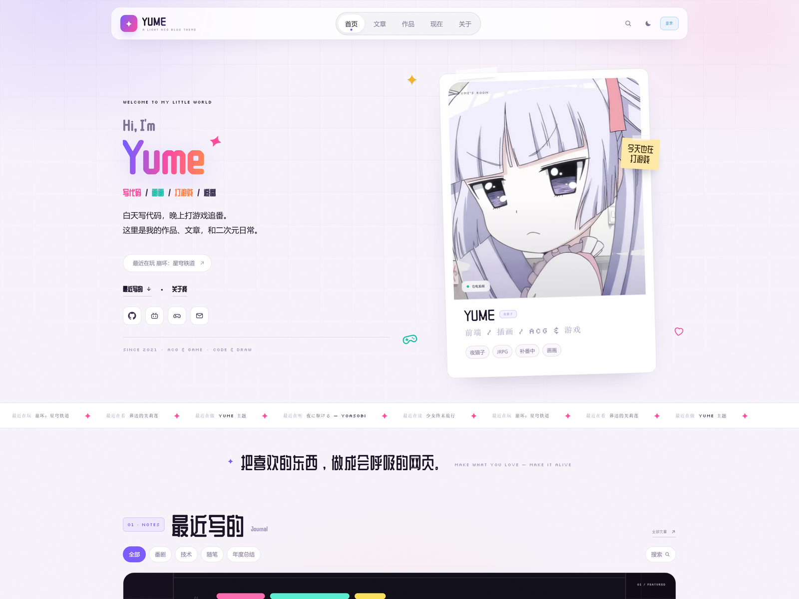
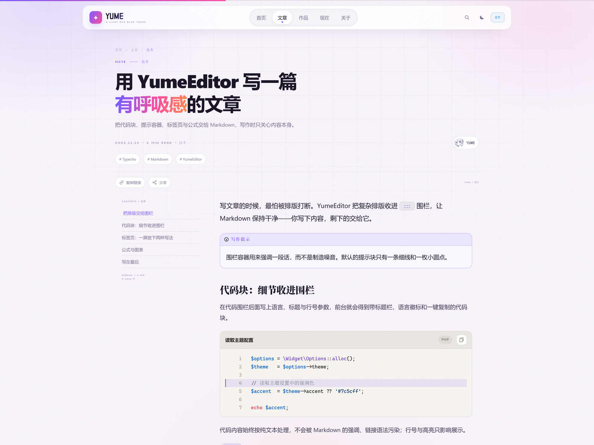
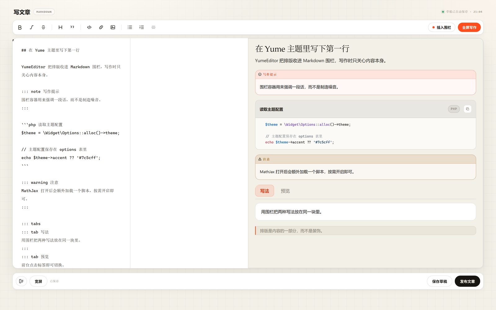
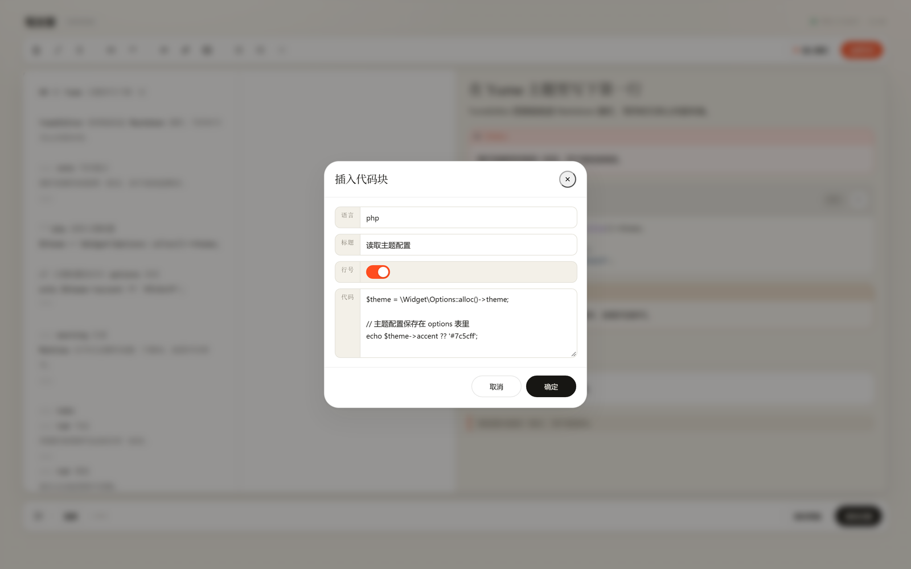
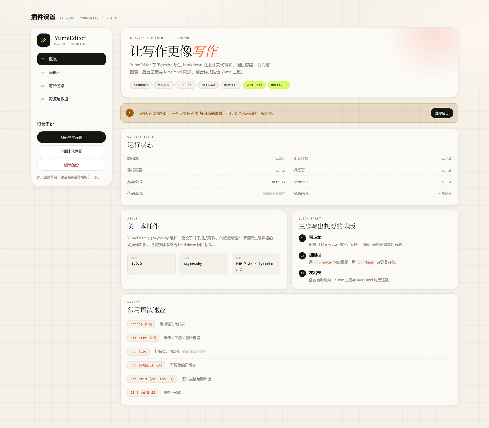
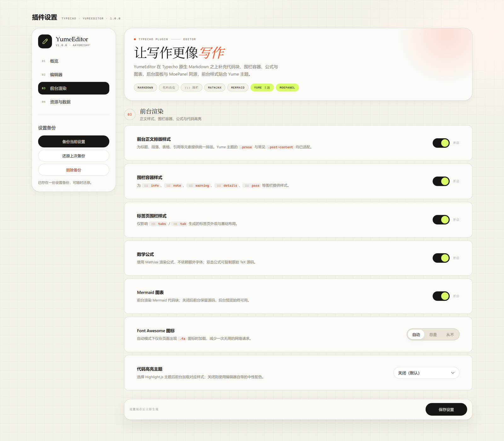
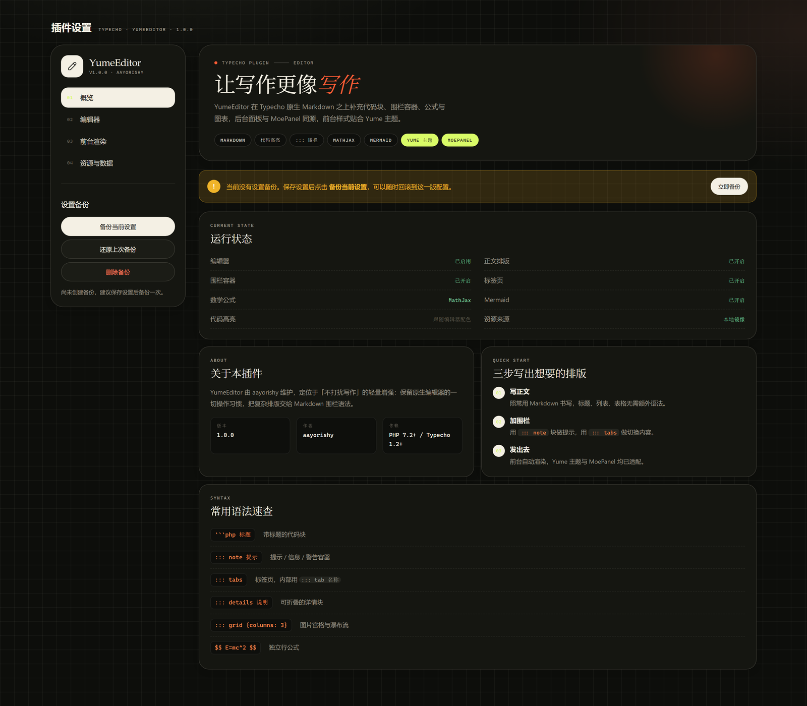
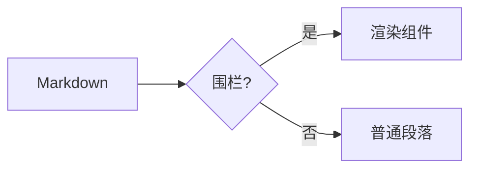

<div align="center">
  
</div>

# YumeEditor

> Typecho 的轻量 Markdown 编辑器，为 **Yume** 主题与 **MoePanel** 后台而生。

[](https://github.com/aayorishy/Typecho-YumeEditor/releases)
[](https://typecho.org/)
[](https://www.php.net/)
[](LICENSE)

YumeEditor 是基于 [AAEditor](https://xiamp.net/archives/aaeditor-is-another-typecho-editor-plugin.html) 二次开发的 Typecho Markdown 编辑器插件。它保留 Typecho 原生写作页的一切习惯，把代码块、围栏容器、数学公式与 Mermaid 图表收进干净的 Markdown 语法；后台界面与 **MoePanel** 同源，前台排版按 **Yume** 主题的正文结构重新适配。

- 不替换编辑器内核，不引入新的写作范式，只补齐原生 Markdown 缺失的排版能力。
- 后台是暖纸色的 MoePanel 设计语言，前台是 Yume 的紫色系阅读体验。
- 默认使用插件内置的静态镜像，不依赖外部 CDN；也支持切换 jsDelivr。
- 兼容 AAEditor 时期的配置键，旧站点升级不需要重新填写设置。

**当前版本：1.0.0（首个正式版）** · 作者：[aayorishy](https://github.com/aayorishy) · 许可证：Apache-2.0

---

## 界面预览

> 以下截图由独立的 YUME Demo 站点生成，不包含任何个人站点数据。

### 博客首页

Yume 主题首页，文章卡片、封面与「最近写的」列表均由 YumeEditor 渲染的正文提供内容。



### 文章页：围栏与代码块

提示容器、带标题和行号的代码块、标签页，都是在 Markdown 里直接写出来的。



### 文章页：公式、图表与图库

MathJax 公式、Mermaid 流程图与 `::: grid` 图片宫格，前台自动接管，无需手写 HTML。


### 写作页与插入弹窗

| 写作页：工具栏、源码与实时预览 | 插入代码块 |
| --- | --- |
|  |  |

### 插件设置

| 设置概览（浅色） | 前台渲染设置项 |
| --- | --- |
|  |  |

| 设置概览（深色） |
| --- |
|  |

---

## 功能特性

### 写作体验：不打断写作

- **原生编辑器增强**：沿用 Typecho 的工具栏、快捷键与自动保存，不改变原有写作习惯。
- **实时预览**：左右分栏预览 Markdown 结果，代码块、围栏、公式与图表在预览区同步呈现。
- **全屏与宽屏**：`Ctrl+J` 进入全屏、`Ctrl+E` 退出；预览区支持宽屏与上下 / 左右布局切换。
- **粘贴图片即上传**：Typecho 1.3+ 使用原生粘贴事件，1.2 走兼容路径；上传完成后自动写入 Markdown。
- **附件插入控制**：可一键插入全部图片；也可按扩展名（如 `zip|pdf`）禁止附件上传后自动写入正文。
- **旧文章转换**：打开非 Markdown 文章时，会提示是否转换为 Markdown 后继续编辑。

### 代码块：细节都可以写在围栏里

- 语言标签、代码标题、行号（可指定起始行）、行高亮、聚焦、diff、警告 / 错误行。
- 一键复制代码；复制按钮带成功 / 失败状态。
- 代码内容按纯文本保护，不会被 Markdown 的强调、链接或围栏语法误伤。
- 内置 200+ 套 Highlight.js 主题，可在设置中选择；默认跟随编辑器配色。

### 围栏容器：用 `:::` 组织内容

| 类型 | 写法 | 用途 |
| --- | --- | --- |
| 信息 | `::: info` / `::: note` | 中性提示、补充说明 |
| 成功 | `::: tip` / `::: success` | 建议、完成提示 |
| 重要 | `::: important` | 需要强调的结论 |
| 警告 | `::: warning` | 风险、注意事项 |
| 危险 | `::: danger` / `::: caution` / `::: error` | 错误、破坏性操作 |
| 折叠 | `::: details 标题`、`::: details:open` | 默认折叠 / 展开 |
| 标签页 | `::: tabs` + `::: tab 名称` | 并列内容切换 |
| 宫格 | `::: grid {columns: 3, gap: 8px}` | 图片或卡片宫格 |
| 瀑布流 | `::: masonry {columns: 3, gap: 16px}` | 不等高图片瀑布流 |
| 原始 HTML | `::: raw` | 不再解析 Markdown，直接输出 |
| 回复可见 | `::: pass:comment` | 评论审核通过后可见 |

围栏支持 `类型[:变体] {属性: 值} 标题` 形式，属性会输出为 `data-*`，便于主题继续定制。完整写法见 [SYNTAX.md](SYNTAX.md)。

### 公式与图表

- **MathJax**：行内 `$...$` 与块级 `$$...$$`；默认加载内置的 CHTML 版本，双击公式可复制原始 TeX。
- **Mermaid**：`mermaid` 代码块自动渲染，支持预览 / 源码切换、缩放、全屏与复制源码；关闭前台渲染后仍保留源码。
- **本地镜像**：MathJax、Mermaid、Highlight.js、Font Awesome 等资源默认由插件内置镜像提供，内网或无外网环境也能正常显示。

### 主题与后台

- 正文排版用 `:where()` 以零优先级注入，Yume 主题的 `.prose` 规则永远优先；插件自带的组件（代码块、围栏、标签页）保持自身样式。
- 设置页与 MoePanel 共用设计令牌：暖纸底色、珊瑚强调色、衬线标题与大圆角；未安装 MoePanel 时自动回退到同款内置变量。
- 深色模式同时响应 Yume 的 `data-theme`、MoePanel 的 `data-studio-theme` 与系统偏好。
- Font Awesome 默认「自动」：页面出现 `.fa` 图标时才加载。

### 数据与安全

- 设置支持一键**备份 / 还原 / 删除**，带 CSRF 校验、管理员权限与来源校验。
- `pass:comment` 的授权凭据使用站点密钥 HMAC 签名，并绑定文章与评论编号；摘要始终隐藏该区块。
- 访客评论审核通过后 30 天内可凭 Cookie 查看；清除 Cookie 或换浏览器需要重新评论。
- 卸载时可选择「保留数据」或「卸载时清理」设置备份，不会擅自删除文章内容。

### 兼容与迁移

- 支持 Typecho 1.2 与 1.3+，编辑器在 1.3 使用原生粘贴事件，在 1.2 使用兼容实现。
- 自动读取 AAEditor 时期的 `XEditor*` 配置键；从 AAEditor 迁移时无需重新配置。
- 与 Yume 主题、MoePanel 的样式变量对齐，也可以单独用于其他 Typecho 主题。

> 说明：点击图片放大的「灯箱」由 Yume 主题提供，不属于本插件；YumeEditor 负责正文排版、图片宫格与图片说明的渲染。

---

## 环境要求

| 组件 | 最低要求 | 推荐 |
| --- | --- | --- |
| PHP | 7.2 | 8.1+（Yume 主题要求 PHP 8.1+） |
| Typecho | 1.2 | 1.3+（Yume 主题要求 1.3+） |
| PHP 扩展 | `dom`、`mbstring`、`json`、`pdo` | 与 Typecho 环境一致 |
| 数据库 | Typecho 支持的 MySQL / PostgreSQL / SQLite | MySQL 5.7+ / 8.0 |
| 浏览器 | 支持 ES6 的现代浏览器 | Chrome / Edge / Firefox / Safari 最新版 |
| 可选 | Yume 主题、MoePanel | 最新版本 |

- 插件本体按 PHP 7.2 语法编写，开发与构建基准为 PHP 8.4。
- 若使用 Yume 主题，请以主题的 [环境要求](https://github.com/aayorishy/Typecho-Yume#环境要求) 为准（Typecho 1.3+ / PHP 8.1+）。
- 开发插件本身需要 Node.js 18+ 与 pnpm 8+；仅安装使用不需要 Node.js。

---

## 安装教程

### 方式一：后台上传（推荐）

1. 打开 [Releases](https://github.com/aayorishy/Typecho-YumeEditor/releases/latest)，下载最新的 `YumeEditor.zip`。
2. 在 Typecho 后台进入「控制台 → 插件 → 上传插件」，选择压缩包并上传。
3. 确认插件目录为 `usr/plugins/YumeEditor/`，且目录内直接能看到 `Plugin.php`。
4. 在插件列表中找到 **YumeEditor**，点击「启用」。
5. 点击插件右侧的「设置」，按需调整前台渲染项；保存后建议立即点一次「备份当前设置」。

### 方式二：手动上传

将仓库中的插件文件放入 Typecho 的插件目录：

```text
你的站点根目录/
└── usr/
    └── plugins/
        └── YumeEditor/
            ├── Plugin.php
            ├── Config.php
            ├── Editor.php
            ├── Front.php
            ├── Content.php
            ├── Util.php
            ├── assets/
            └── ...
```

也可以直接克隆仓库：

```bash
cd /path/to/typecho/usr/plugins
git clone https://github.com/aayorishy/Typecho-YumeEditor.git YumeEditor
```

> 目录名必须是 `YumeEditor`。如果解压后得到 `Typecho-YumeEditor-main` 之类的名字，请重命名。

### 方式三：从 AAEditor 迁移

1. 先在后台**停用 AAEditor**，不要与 YumeEditor 同时启用（两者会注册相同的编辑器钩子）。
2. 按上面的方式安装并启用 YumeEditor。
3. 打开插件设置确认配置；插件会自动回退读取 AAEditor 的 `XEditor*` 配置键，原有选项无需重填。
4. 如果之前使用过 `::: pass:comment`，请**停用再重新启用**一次 YumeEditor，以注册新的评论完成钩子。

### 升级

1. 在插件设置中备份当前配置。
2. 覆盖 `usr/plugins/YumeEditor/` 下的文件（`assets/dist` 已包含构建产物）。
3. 如果从 1.0.0 之前的测试版本升级，建议停用后再启用一次，确保评论授权钩子更新。
4. 清理浏览器缓存或 CDN 缓存；插件静态资源带有内容指纹，正常刷新即可。

### 卸载

在插件列表停用 YumeEditor 即可。停用行为由设置中的「禁用插件时的数据策略」决定：

- **保留数据**（默认）：保留设置与备份，下次启用可继续使用。
- **卸载时清理**：删除本插件生成的设置备份；文章内容与 Typecho 设置本身不受影响。

---

## 快速开始

新建或编辑一篇文章，确保使用 Markdown 模式，然后直接写：

````markdown
## 一个带标题和行号的代码块

```php:line-numbers {2} [读取主题配置]
$theme = \Widget\Options::alloc()->theme;

echo $theme->accent ?? '#7c5cff';
```

::: note 写作提示
围栏容器用来强调一段话，而不是制造噪音。
:::
````

保存后前台会得到带语言徽标、标题、行号与高亮的代码块，以及一个提示容器。更多写法：

### 标签页

````markdown
::: tabs
::: tab 安装
npm install
:::
::: tab 使用
npm run dev
:::
:::
````

### 图片宫格

````markdown
::: grid {columns: 3, gap: 10px} 示例图集


:::
````

### 数学公式

```markdown
行内公式 $E = mc^2$。

$$
\int_0^1 x^2 \, dx = \frac{1}{3}
$$
```

### Mermaid 图表

````markdown

````

### 回复可见

````markdown
::: pass:comment
这段内容在评论审核通过后可见。
:::
````

完整语法、代码行注释标记、宫格属性与 `pass:comment` 的权限细节见 [SYNTAX.md](SYNTAX.md)。

---

## 设置项

| 设置 | 默认 | 说明 |
| --- | --- | --- |
| 启用编辑器 | 开启 | 关闭后写作页回到原生输入框，仅保留前台渲染 |
| 一键插入全部图片 | 开启 | 在附件面板增加「插入所有图片」 |
| 禁止自动插入附件的后缀 | 空 | 例如 `zip\|pdf`，命中的附件上传后不写入正文 |
| 前台正文排版样式 | 开启 | 标题、段落、表格、引用等基础排版 |
| 围栏容器样式 | 开启 | `info` / `note` / `warning` / `details` / `pass` 等围栏 |
| 标签页围栏样式 | 开启 | `::: tabs` / `::: tab` 的外观与基础布局 |
| 数学公式 | 开启 | MathJax 渲染；关闭后保留公式源码 |
| Mermaid 图表 | 开启 | 前台渲染 Mermaid 代码块 |
| Font Awesome 图标 | 自动 | 页面出现 `.fa` 图标时才加载 |
| 代码高亮主题 | 关闭 | 选择 Highlight.js 主题后前台加载；关闭则跟随编辑器配色 |
| jsDelivr 镜像 | 本地镜像 | 本地镜像随插件分发，无需外网；可切换公共镜像 |
| 禁用插件时的数据策略 | 保留数据 | 选择「卸载时清理」会删除设置备份 |

---

## 目录结构

```text
YumeEditor/
├── Plugin.php            # 插件入口与元信息
├── Config.php            # 设置页（MoePanel 风格）
├── Editor.php            # 后台编辑器资源与写作页增强
├── Front.php             # 前台资源注入
├── MathJax.php           # 公式支持
├── Content.php           # Markdown、围栏与摘要后处理
├── Util.php              # 配置、资源 URL 与通用工具
├── HyperDown.php         # Markdown 解析器
├── assets/
│   ├── src/              # SCSS / JS 源码
│   ├── dist/             # 构建产物（已纳入版本控制）
│   ├── json/             # 表情、字符与符号配置
│   └── mirror/           # CDN 资源本地镜像
├── docs/
│   ├── preview/          # 文档截图
│   └── development.md    # 开发约定
├── tests/                # PHP / JavaScript 测试
├── SYNTAX.md             # 完整语法说明
├── CHANGELOG.md
├── LICENSE
└── README.md
```

---

## 开发与构建

```bash
pnpm install          # 安装依赖
pnpm run dev          # 开发模式（BrowserSync 代理 localhost）
pnpm run watch        # 监听源码变化
pnpm run build        # 生产构建，输出到 assets/dist
pnpm test             # PHP + JavaScript 测试
```

`assets/dist` 已纳入版本控制，修改 `assets/src` 后必须重新构建并运行测试。测试需要本机可执行的 PHP：

```bash
# macOS / Linux
PHP_BINARY=/path/to/php pnpm test

# Windows PowerShell
$env:PHP_BINARY="C:\php\php.exe"; pnpm test
```

> Release 中的 `YumeEditor.zip` 只包含运行所需文件；`package.json`、`assets/src` 与 `tests` 仅随仓库提供。二次开发请克隆完整仓库。

详细的代码约定、构建流程与发布检查见 [docs/development.md](docs/development.md)。

---

## 常见问题

### 前台没有插件样式？

先确认插件已启用，并在设置中打开「前台正文排版样式」与「围栏容器样式」。如果使用了缓存插件或 CDN，请清理缓存。Yume 主题的 `.prose` 规则优先级高于插件的基础排版，这是预期行为。

### 代码块没有颜色？

前台代码高亮默认关闭（跟随编辑器配色）。在设置中选择一套 Highlight.js 主题即可；代码块的标题、行号与复制按钮不依赖高亮主题。

### 复制按钮不可用？

复制优先使用 `navigator.clipboard`，需要 HTTPS 或 localhost；其他环境会回退到 `document.execCommand('copy')`。若浏览器仍拦截，可手动选中代码复制。

### 公式或 Mermaid 不显示？

检查设置中的「数学公式」「Mermaid 图表」开关。Mermaid 代码块的围栏语言必须是 `mermaid`；公式的行内分隔符为 `$`、块级为 `$$`。使用本地镜像时不需要外网，若切换了公共镜像请确认 CDN 可访问。

### `::: pass:comment` 内容一直不可见？

- 管理员可以直接查看。
- 访客需要先提交评论，且评论审核通过；凭据有效期为 30 天，清除 Cookie 或换浏览器后需要重新评论。
- 如果刚刚升级过插件，请停用再启用一次，让评论完成钩子重新注册。

### 从 AAEditor 升级后设置丢失？

YumeEditor 会优先读取自己的配置，缺失时回退读取 AAEditor 的 `XEditor*` 键。请确认数据库中没有手动删除 `plugin:AAEditor` 配置；如仍异常，在插件设置中重新保存一次即可。

### 图片点击后没有放大？

图片灯箱是 Yume 主题的能力，YumeEditor 提供的是图片宫格（`::: grid`）、瀑布流（`::: masonry`）与正文中的图片渲染。使用其他主题时，灯箱效果取决于主题或灯箱插件。

### 可以和其他编辑器插件一起用吗？

不建议。编辑器类插件通常会接管同一批后台钩子；请只启用一个 Markdown 编辑器插件。

---

## 致谢

- [AAEditor](https://xiamp.net/archives/aaeditor-is-another-typecho-editor-plugin.html)：本项目的二次开发基础。
- [HyperDown](https://github.com/SegmentFault/HyperDown)：Markdown 解析器（BSD License）。
- [MoePanel](https://github.com/aayorishy)：后台设计语言与设计令牌。
- [YUME](https://github.com/aayorishy/Typecho-Yume)：前台排版与主题适配目标。
- Highlight.js、Mermaid、MathJax、Font Awesome 及所有开源依赖的作者。

## License

[Apache-2.0](LICENSE) © 2026 aayorishy
